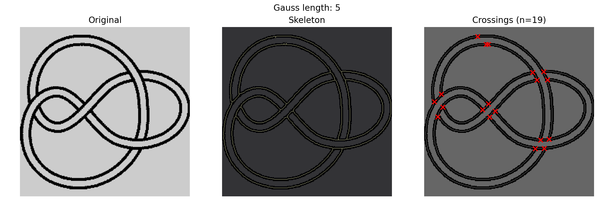
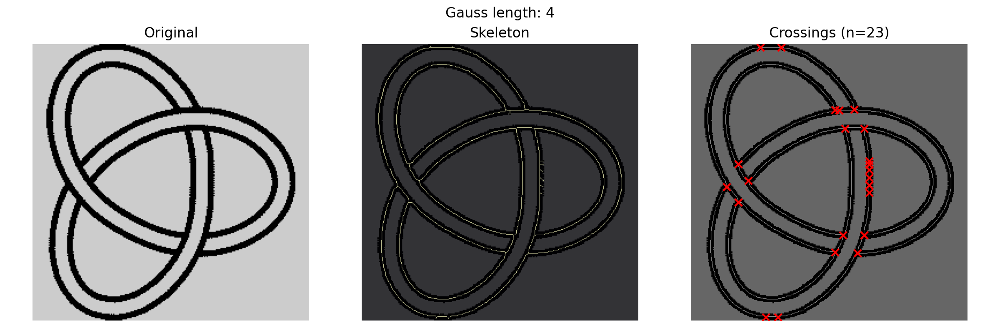
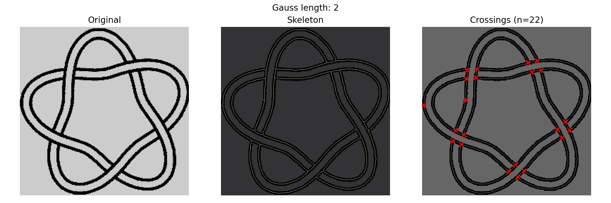

# Visualizations

This document reports qualitative visualizations generated by the diagnostic preprocessing and skeletal extraction pipeline. Each figure shows (1) the original image, (2) the skeletonized representation, and (3) detected crossing locations overlaid on the skeleton. The metrics below are reported directly from heuristic traversal diagnostics and should be interpreted as developmental inspection tools, not verified topological ground truth.

## Method & Generation Provenance
- **Generating Code Revision**: Git commit `c0080e0` (refined in `9aa6322`).
- **Generation Pipeline & Configuration**:
  - Image Preprocessing: `PreprocessConfig(width=512, blur_kernel=5, adaptive_block=15, adaptive_c=2.0)` (grayscale, histogram equalization, Gaussian smoothing, adaptive thresholding with Otsu fallback, morphological opening, skeletonization).
  - Graph Extraction: `GaussPDConfig(spur_length=5, cluster_radius=5.0)` via `GaussPDExtractor.extract(skeleton)` (`skeleton_to_graph`, `prune_spurs`, `cluster_junctions`, `simplify_graph`, and cycle traversal).
- **Topology vs. Traversal Output**: In formal knot theory, a valid Gauss code for a closed knot with $N$ crossings visits each crossing twice along its oriented path, producing a sequence of length exactly $2N$ (e.g., length 6 for $3_1$, length 8 for $4_1$, length 10 for $5_1$). The "heuristic traversal sequence lengths" reported below are **not valid complete closed-knot Gauss codes**; they represent partial or fragmented cycle traversals across raw, unpruned junction cliques.

## Figure Eight Knot (4_1)
**Source**: `raw_knot/4_1/4_1.gif`  \
**Output**: `results/figures/figure_eight_visualization.png`  \
**Detected candidate junctions**: 19 (expected crossings: 4)  \
**Heuristic traversal sequence length**: 5 (expected closed Gauss code length: 8)

**Observation**: The pipeline detects a dense cluster of candidate junctions relative to the minimal crossing number (4). This indicates that junction clustering and spur pruning on this raster GIF produce spurious degree-4 vertices, leading to fragmented path traversal rather than a single 4-crossing closed circuit.

## Trefoil Knot (3_1)
**Source**: `raw_knot/3_1/3_1.gif`  \
**Output**: `results/figures/trefoil_visualization.png`  \
**Detected candidate junctions**: 23 (expected crossings: 3)  \
**Heuristic traversal sequence length**: 4 (expected closed Gauss code length: 6)

**Observation**: Spurious junction cliques inflated by stroke thickness artifacts inflate the junction count beyond the nominal 3 crossings. The traversal terminates early along a sub-loop, yielding an incomplete 4-entry sequence instead of a full 6-entry Gauss code.

## Five-One Knot (5_1)
**Source**: `raw_knot/5_1/5_1.gif`  \
**Output**: `results/figures/five_one_visualization.png`  \
**Detected candidate junctions**: 22 (expected crossings: 5)  \
**Heuristic traversal sequence length**: 2 (expected closed Gauss code length: 10)

**Observation**: Severe over-segmentation of junction pixels splits true crossings into multiple disconnected candidate vertices. The resulting skeleton graph fragments the continuous strand into isolated short paths, highlighting the sensitivity of heuristic thinning to raster stroke boundaries.

## Notes and Limitations
- Candidate crossing counts are derived from raw clustered skeleton junctions and are sensitive to binarization, stroke thickness, and thinning artifacts.
- Traversal sequence lengths reflect heuristic path tracing over skeletal graphs; they do not satisfy closed-loop completeness ($2N$) and must not be used as verified topological invariants.
- These figures serve exclusively as qualitative diagnostics for tuning clustering radii and skeleton pruning algorithms.
